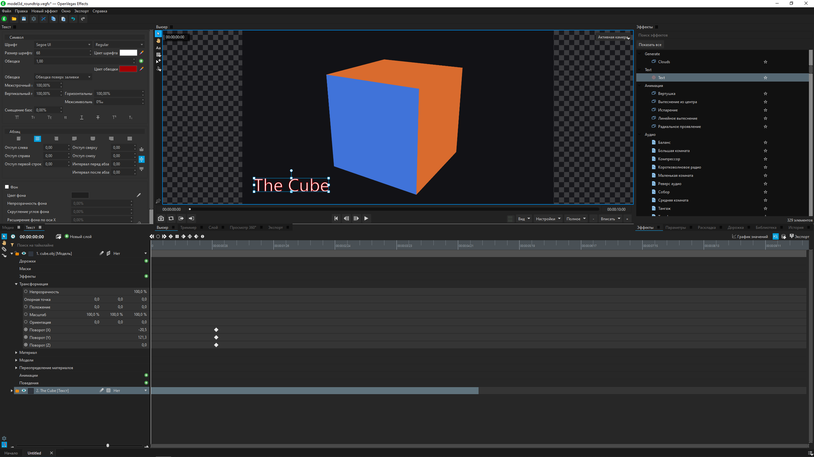

# OpenVegas Effects

<p align="center">
  <a href="README.md">English</a> |
  <a href="README.zh.md">简体中文</a> |
  <a href="README.ja.md">日本語</a> |
  <a href="README.ru.md">Русский</a>
</p>



以 **VEGAS Effects** 为蓝本的合成／特效应用程序的开源（净室）重新实现，使用
**C++17 / Qt 6** 编写，采用 **GNU GPL v3** 许可证。

代码依据对参考程序二进制文件进行逆向工程所发现的行为架构从零编写（参见
[`MARKDOWN/RE_VegasEffects.md`](MARKDOWN/RE_VegasEffects.md)）。这是**原创代码**：
没有复制任何专有源代码。模块布局与参考程序可观察到的高层结构保持一致，以便项目逐步
成长为兼容的工作流程，但每一行代码都是重新编写的。

当前状态：**参考程序的大部分合成工作流程已可在 Windows 上运行** —— 参考程序 `.vegfx`
格式的项目、带有嵌套合成镜头的时间轴、2D 与 3D 图层、文本、模型、蒙版与跟踪、
VEGAS Effects 的原生 `.hfpl` 插件、音频和导出。未完成的事项列在
[`MARKDOWN/CHECKLIST.md`](MARKDOWN/CHECKLIST.md) 中。

---

## 已实现的功能

| 方面 | 状态 |
|------|------|
| 项目：参考程序的 `.vegfx` 格式（读取与写入）、相对路径、自动保存与恢复 | 已完成 |
| 时间轴：合成镜头、在标签页中打开的嵌套镜头、2D／3D 图层、剪辑、切片与速率拉伸、关键帧与数值曲线图、转场 | 已完成 |
| VEGAS Effects 的原生 `.hfpl` 插件：全部 321 个模块均可运行（241 个 2D 特效、43 个 Behavior、16 个音频特效、15 个视频转场、4 个 Geometry、2 个音频转场）；其控件、查看器中的自定义界面和 `.hfpr` 预设 | 已完成 |
| OpenFX 插件：OpenFX 1.4 宿主（`OFX_PLUGIN_PATH`、`Common Files\OFX\Plugins`），效果面板中的滤镜与转场，插件缓存与独立进程描述，按参考程序的 FXID 保存到 `.vegfx` | 已完成（尚未用商业插件验证） |
| 文本图层：样式、3D 挤出、逐字 Behavior、Text 面板 | 已完成 |
| 3D：模型（OBJ、带蒙皮和混合形状的 FBX、glTF、3DS、LWO，Alembic 可选）、摄像机、灯光、阴影、逐像素深度 | 已完成 |
| 蒙版、运动跟踪（MotionTrack）、稳定 | 已完成 |
| 按图层导入 Photoshop 文档（`.psd`、`.psb`）：混合模式、组、蒙版、剪贴、图层样式、调整图层，以及将 Camera Raw 和高斯模糊智能滤镜转为可编辑效果的智能对象；源为 Photoshop 文档的智能对象成为该文档自己的镜头，其图层被锁定；曲线和 Camera Raw 调色转为 LUT | 已完成 |
| 带叠加层和缩小预览的查看器、360 查看器、Layer、Trimmer 和 Layout 面板 | 已完成 |
| 音频：libVLC 播放、主混音、Audio Meters、实时原生音频特效、画外音录制 | 在 Windows 上已完成 |
| 导出：通过 FFmpeg 导出视频、图像序列和音频，导出队列与预设，OpenEXR（可选） | 已完成 |
| 代理、预渲染、媒体缓存、帧磁盘缓存 | 已完成 |
| 俄语、日语和简体中文界面，包括插件字符串 | 已完成 |
| Windows 安装程序（NSIS）；`.deb` 和 `.rpm` 软件包 | Windows 已验证；Linux 软件包未验证 |
| macOS／Linux 上的音频和 VLC 4 | 未验证 |

详细信息见 [`MARKDOWN/ARCHITECTURE.md`](MARKDOWN/ARCHITECTURE.md) 以及
[`MARKDOWN/`](MARKDOWN/) 中的逆向工程笔记。

---

## 技术栈

| 层 | 选择 |
|----|------|
| 语言／界面 | C++17、Qt 6（Widgets、OpenGL；表单位于 `ui/`，其余在代码中构建） |
| 构建 | CMake 3.21+（推荐）和 `OpenVegasEffects.pro` |
| 编译器 | MSVC 2022（主要）、MinGW／LLVM-MinGW、GCC、Clang |
| 媒体 | **libVLC** —— 视频帧、PCM 主混音、音频输出和画外音录制 |
| 导出、代理、波形 | `PATH` 中的 **FFmpeg** 可执行文件 |
| 缓存 | QtSql（SQLite `cache.db`）和帧磁盘缓存 |
| 插件 | VEGAS Effects 原生 `.hfpl` 模块的宿主（OpenGL 4.1） |
| 许可证 | GNU GPL v3（[LICENSE](LICENSE)） |

---

## 构建与运行

需要 **Qt 6.8+**（Core/Gui/Widgets/OpenGLWidgets/Sql/Svg/Xml；翻译需要
LinguistTools）。不需要 Qt WebEngine。在 Windows 上，如果因文件被占用而链接失败，请在
重新构建前关闭 `OpenVegasEffects.exe`。

### 原生插件（`.hfpl`）

特效、转场、音频特效、Behavior 和 Geometry 模块是参考程序自带的 `.hfpl` 文件，由移植版的
宿主执行。它们不包含在本仓库中。应用程序会在已安装的 VEGAS Effects
（`C:\Program Files\FXhome\VEGAS Effects\Plugins`）或在 **选项 → 插件** 中选择的文件夹里
查找它们（其他 FXhome 程序的插件也可以使用）。没有这些插件时，内置特效仍然可用。

### libVLC（媒体）

不使用 Qt Multimedia。libVLC 负责解码视频和音频、输出 PCM 主混音并录制麦克风。混音器会
考虑剪辑区间、静音、源偏移、速度、电平和嵌套合成；Audio Meters 测量的是同一个最终 PCM。
速度变化使用带音高偏移的重采样。原生 `.hfpl` 音频特效和音频转场在实时混音和音频导出中
都会运行。

VLC 的头文件和源代码位于 `thirdparty/vlc`。这是源代码树，而不是现成的运行时。
`Vlc4Adapter.cpp` 适配器使用其头文件并检查 VLC 4 的 ABI；VLC 3 使用另一套兼容的签名。
已在 Windows 版 VLC 3.0.24 上验证运行；VLC 4 适配器可以构建，但在 VLC 4 上运行以及在
macOS／Linux 上的测试尚未完成。

打包时，请在 `thirdparty/vlc/runtime/Windows`、`Darwin` 或 `Linux` 中为目标架构准备
运行时：库及其依赖项和插件。也可以通过 CMake 选项 `-DOPENVEGAS_VLC_RUNTIME_DIR=<prefix>`
指定其他前缀；qmake 读取同名环境变量。在 Windows 上，如果没有准备好的运行时，则使用
安装在 Program Files 中的 VLC。两种构建都会把运行时复制到 EXE 旁边的 `vlc` 中；CMake
安装会保留这一结构，NSIS 会验证 DLL 和插件是否存在。还会随附 `COPYING` 和 `COPYING.LIB`。

加载器依次在 `OPENVEGAS_VLC_DIR`（运行时覆盖）、应用程序旁边、配置的前缀和系统目录中
查找库。支持 Windows 的 DLL、macOS 的 dylib 和 Linux 的 SONAME；不需要导入库。没有可用
的 libVLC 时应用程序仍可启动，但媒体和录制不可用。录制使用 DirectShow、qtsound 或
PulseAudio；在 Linux 上通过 `pactl` 枚举设备（也兼容 PipeWire 的 Pulse）。设备录制和
音频输出需要在目标操作系统上单独验证；测试检查的是 PCM 和 VLC 播放器的状态。

### Qt Creator（qmake）

打开 [`OpenVegasEffects.pro`](OpenVegasEffects.pro)，选择套件 **Qt 6.8+ Widgets**
（MSVC／MinGW／Clang）→ 构建。请保持 `SOURCES`／`HEADERS` 与 `CMakeLists.txt` 一致。

在 Windows 上，qmake 会为 Qt Creator 的构建步骤生成最新的 `Makefile.Debug` 和
`Makefile.Release`。表单头文件、moc／rcc 输出、目标文件和翻译目录按配置分开；可执行
文件位于影子构建中的 `debug/` 或 `release/`。编辑 `.pro` 后，请执行 **构建 → 运行
qmake**。来自其他配置的过时 Makefile 可能导致 `ui_*.h` 出现 `C1083`，即使新的顶层
Makefile 已经就位。

### MSVC（预设）

[`CMakePresets.json`](CMakePresets.json) 中的预设是各 IDE 共用的唯一配置来源：

每个构建都位于 `build/<操作系统>_<编译器>-<架构>-<配置>/`：

| 预设 | 工具链 | 目录 |
|------|--------|------|
| `windows-msvc-debug` / `-release` | MSVC v143（VS 2022）+ Qt `msvc2022_64`；Release 为 RelWithDebInfo | `build/Windows_MSVC-x64-Debug/`、`build/Windows_MSVC-x64-Release/` |
| `windows-mingw-debug` / `-release` | MinGW GCC + Qt `mingw_64` | `build/Windows_MinGW-x64-Debug/`、`-Release/` |
| `windows-llvm-debug` / `-release` | LLVM-MinGW Clang + Qt `llvm-mingw_64` | `build/Windows_LLVM-x64-Debug/`、`-Release/` |
| `linux-debug` / `-release` | GCC + 系统 Qt | `build/Linux_GCC-x64-Debug/`、`-Release/` |
| `linux-llvm-debug` / `-release` | Clang + 系统 Qt | `build/Linux_LLVM-x64-Debug/`、`-Release/` |
| `macos-debug` / `-release`、`macos-x64-debug` / `-release` | Apple Clang，Apple 芯片 / Intel | `build/macOS_LLVM-arm64-Debug/`、`build/macOS_LLVM-x64-Debug/` 等 |

此外：回归测试位于 `build/Windows_MSVC-x64-Release-Tests/`（[`tests/`](tests/)），安装程序暂存位于
`build/Windows_MSVC-x64-Release-Installer/`，Qt Creator 的 qmake 构建位于 `build/Windows_MSVC-x64-Debug-qmake/` 等。

在 **x64 Native Tools Command Prompt for VS 2022** 窗口中：

```bat
cmake --preset windows-msvc-debug
cmake --build --preset windows-msvc-debug --parallel
```

在普通终端中，可以用会自行加载 MSVC 环境的 `tools\msvc_build.cmd` 完成同样的操作：

```bat
tools\msvc_build.cmd build windows-msvc-debug
```

该脚本可以在任意目录运行。不带参数时执行 `buildall windows-msvc-debug`（配置并构建）；
还支持 `configure`、`build`、`probe` 和 `clean`。例如
`tools\msvc_build.cmd clean windows-msvc-release` 会通过 CMake 只清理 Release 的产物，
保留构建配置。

### 使用 MinGW 的 CMake

```bash
cmake -S . -B build -G "MinGW Makefiles" ^
  -DCMAKE_PREFIX_PATH=C:/Qt/6.9.3/llvm-mingw_64 ^
  -DCMAKE_C_COMPILER=C:/Qt/Tools/llvm-mingw1706_64/bin/clang.exe ^
  -DCMAKE_CXX_COMPILER=C:/Qt/Tools/llvm-mingw1706_64/bin/clang++.exe ^
  -DCMAKE_MAKE_PROGRAM=C:/Qt/Tools/llvm-mingw1706_64/bin/mingw32-make.exe
cmake --build build -j 8
```

### Linux 和 macOS

`tools/build_deb.sh` 和 `tools/build_rpm.sh` 构建 `openvegaseffects` 软件包（`.deb`
通过 dpkg-buildpackage，`.rpm` 通过 rpmbuild）；软件包包含应用程序、桌面项和图标。在
macOS 上，`tools/setup_macos.sh` 通过 Homebrew 安装 Qt 6、CMake 和 Ninja，
`tools/macos_build.sh [debug|release] [test] [deploy]` 使用预设进行构建。这些流程尚未
验证。

### Windows 安装程序

安装程序由一个脚本构建，可在任意目录运行：

```bat
tools\build_windows_installer.bat
```

脚本会自动找到 Visual Studio 2022（vswhere）和 Qt 的 `msvc2022_64` 套件，在
`build\Windows_MSVC-x64-Release-Installer` 中用 Ninja 构建 Release，安装到全新的前缀，用 windeployqt
部署 Qt，把 MSVC 运行时 DLL 复制到 EXE 旁边，并生成 `tools\OpenVegasEffects_Setup.exe`。
`CMAKE_PREFIX_PATH` 可选择其他 Qt 套件，`OPENVEGAS_VLC_RUNTIME_DIR` 可选择其他 libVLC
运行时；用其他生成器、编译器或 Qt 套件配置的构建目录会重新创建。

手动执行时步骤相同（`copy` 一行需要设置了 `VCToolsRedistDir` 的
Developer Command Prompt for VS 2022）。在项目根目录下：

```bat
tools\msvc_build.cmd buildall windows-msvc-release
cmake --install build\Windows_MSVC-x64-Release --prefix build\installer-stage
"C:\Qt\6.9.3\msvc2022_64\bin\windeployqt.exe" --release --no-compiler-runtime build\installer-stage\bin\OpenVegasEffects.exe
copy "%VCToolsRedistDir%x64\Microsoft.VC143.CRT\*.dll" build\installer-stage\bin\
"C:\Program Files (x86)\NSIS\makensis.exe" /DBUILD_DIR=build\installer-stage /DOUTPUT_FILE=build\OpenVegasEffects_Setup.exe tools\nsis_installer.nsi
```

NSIS 需要准备好的 `bin`，其中包含应用和 `platforms\qwindows.dll`。编译期间，
`tools/nsis_payload.ps1` 会通过 Windows PowerShell 生成文件列表，包括嵌套的 Qt 资源和
添加到前缀中的插件。卸载时使用该列表，并且只删除已变为空的目录。

`.vegfx` 项目文件使用 `resources/icons/iconfile.svg` 图标显示：它作为第二个图标嵌入 EXE
（索引 1，`resources/icons/iconfile.ico`，可用 `python tools/make_file_icon.py`
重新生成）。安装程序在 ProgID `OpenVegasEffects.Project` 的 `DefaultIcon` 中引用它，程序
启动时会为当前用户注册相同的 ProgID、`OpenWithProgids` 和
`Applications\OpenVegasEffects.exe`（`app/FileAssociation`）——因此便携版在被选为默认
程序（“打开方式 → 始终使用”）时也会显示该图标。程序不会自行把自己设为 `.vegfx` 的默认
程序。

### 测试与 CI

回归测试是 [`tests/`](tests/) 中独立的 CMake 项目，参见
[`tests/README.zh.md`](tests/README.zh.md)。每次推送到 `main`、提交拉取请求或手动运行时，
[CI](.github/workflows/ci.yml) 工作流会使用 MSVC 2022 和 Qt 6.9.3 构建应用程序，通过
CTest 运行六个测试套件，并校验翻译目录。音频测试使用 VideoLAN 官方服务器上的 libVLC
3.0.24（压缩包按 SHA-256 固定）和 `dummy` 输出，因此即使运行器上没有音频设备，也能检查
解码和主混音。运行原生插件的测试需要 OpenGL 4.1 上下文，没有时会自动跳过。

### Learn 面板（不使用 Qt WebEngine）

参考程序在 Home／Learn 中显示 VEGAS 在线教程，并通过 Qt WebEngine 显示基于网页的素材库。
移植版没有教程，素材库是原生面板，因此不使用 WebEngine：**Learn** 面板由普通控件构成，
提供相同的操作（在系统浏览器中打开教程、新建合成镜头、导入媒体）。通过 **窗口 →
切换学习侧边栏** 开关，状态会被记住（`learnSidebarIsOpen`）。帮助同样在系统浏览器中打开。

### OpenEXR（将帧导出为 `.exr`）

Qt 没有 EXR 写入插件，因此 Export 面板中的 **OpenEXR (.exr)** 预设只在带 OpenEXR 的构建中
可用。默认关闭：

```bat
cmake --preset windows-msvc-debug -DOPENVEGAS_WITH_OPENEXR=ON
```

查找顺序：先找已安装的 `find_package(OpenEXR 3 CONFIG)`，否则使用
[`thirdparty/openexr`](thirdparty/openexr) 中的源代码。

**关于依赖项的说明。** `thirdparty/openexr` 旁边没有 Imath，因此 CMake 中的 OpenEXR 会在
配置时直接从 GitHub（`main` 分支）拉取 Imath——这意味着构建不再是离线且可复现的。克隆的
OpenEXR 本身是 `main` 分支上的 `4.0.0-dev` 版本，而参考程序随附的是稳定版 3.1。为了可
复现性，应固定发布标签，并把 Imath 一并纳入仓库。

不启用此选项时，导出 `.exr` 不会静默失败，而是提示该构建没有 OpenEXR。Alembic（`.abc`）
导入同样可以通过 `-DOPENVEGAS_WITH_ALEMBIC=ON` 从
[`thirdparty/alembic`](thirdparty/alembic) 启用。

### VS Code 和 Zed（Qt MSVC 调试）

两个 IDE 都针对 Qt `msvc2022_64` 进行了配置，并会自行获取 MSVC 环境——无需单独的开发者
命令提示符；构建任务会调用 `vcvars64.bat`（通过 `vswhere -version "[17.0,18.0)"`，以免
选中同时安装、工具集与 Qt 套件不匹配的 VS 18）。

CMake Tools 的构建按钮启用了 `cmake.useVsDeveloperEnvironment=always`，而
`cmake.buildTask=false` 让扩展连同预设环境一起负责启动。`Ctrl+Shift+B` 任务和 F5 之前的
构建会调用自行加载 MSVC 环境的 `tools/msvc_build.cmd`。对于 Ninja，CMake 还会生成
`msvc_environment.cmd`：编译和链接命令会加载所选 `cl.exe` 所属安装的环境。这样即使
CMake Tools 选择了更新版本 Visual Studio 的环境，也能避免把 VS 2022 编译器与 VS 2026
头文件混用时出现的 `STL1001`。对于已有的构建目录，请运行一次配置以刷新 Ninja 规则。
启动脚本还会启用 UTF-8（`chcp 65001`）：否则本地化的 `/showIncludes` 行可能与 CMake 的
前缀不匹配，Ninja 会丢失头文件依赖，并在类发生变化后混用不兼容的目标文件。如果目录已经
用错误的代码页构建过，请在配置后运行
`cmake --build build/Windows_MSVC-x64-Debug --target clean` 并完全重新构建。

- **VS Code** —— [`.vscode/`](.vscode/)：`launch.json`（`cppvsdbg` 调试器，读取 MSVC
  的 PDB；Debug／RelWithDebInfo／附加配置）、`tasks.json`（配置／构建／清理／运行）、
  `qt6.natvis`（在调试器中以可读形式显示 `QString`、`QList`、`QRect` 等）。扩展列在
  `extensions.json` 中。按 F5 构建并运行。
- **Zed** —— [`.zed/debug.json`](.zed/debug.json)（CodeLLDB 适配器，PDB 位于 exe 旁边）
  以及使用相同预设的 [`.zed/tasks.json`](.zed/tasks.json)。`clangd` 会索引
  `build/Windows_MSVC-x64-Debug/compile_commands.json`。

在 IDE 之外运行时，请把 Qt 的 `bin` 加入 PATH：

```powershell
$env:PATH = "C:/Qt/6.9.3/msvc2022_64/bin;" + $env:PATH
```

**不要提交** `build/` —— 它已在 [`.gitignore`](.gitignore) 中。

---

## 本地化

界面已翻译为俄语、日语和简体中文；源语言为英语。

| 目录 | 消息数 | 语言 |
|------|-------:|------|
| 界面（`openvegaseffects_<lang>.ts`） | 1905 | ru、ja、zh_CN —— 全部已翻译 |
| 插件字符串（`openvegaseffects_plugins_<lang>.ts`） | 6818 | ru、ja、zh_CN |

日语和中文术语取自参考程序自身的翻译目录
（`SAMPLES/VEGAS_Effects/Translations/*/VegasEffects_*.qm`）：源文本一致的字符串使用参考
程序的措辞。插件目录在参考程序的 `Effect_<ShortName>` 上下文中包含原生插件的名称、类别、
控件标签、单位、列表项和消息，由 [`tools/plugin_translations.py`](tools/plugin_translations.py)
生成。详情见 [`translations/README.zh.md`](translations/README.zh.md)。

### 工作原理

- 翻译目录位于 [`translations/`](translations/)；CMake 通过 `qt_add_translations` 编译
  它们，并以 `:/i18n/` 嵌入二进制文件。需要 Qt 的 **LinguistTools** 组件；没有它构建也能
  成功，但界面保持英文。
- 加载由 `app::Translations::install()` 完成，在创建控件**之前**于 `main.cpp` 中调用。
- 查找顺序与参考程序一致：先找
  `<用户数据>/Translations/<locale>/openvegaseffects_<locale>.qm`（可以放入自己的翻译
  目录），然后是内嵌的目录。Qt 自身的 `qt_<locale>.qm` 也会一并加载。
- 语言在 **选项 → 接口 → 语言** 中选择，键为 `Options/Language`；为空表示跟随系统。
  下次启动时生效。
- 两个测试会以每种语言打开选项和各面板，只要有文本仍显示英文单词就会失败。

### 编辑字符串后更新翻译目录

```bat
cmake --build --preset windows-msvc-debug --target update_translations
python tools/validate_translations.py
```

---

## 运行时数据文件夹

首次启动时，应用程序会创建用户数据文件夹，复现参考程序的布局（从其解析函数
`FUN_14025b000` 中恢复）：`Translations`、`Templates\AV`、`EnvironmentMaps`、
`ExportPresets`、`PluginPresets`、`Plugins`、`Presets`、`Textures`、
`Templates\Workspaces`、`Objects`、`Tutorials`。其中两个嵌套在 `Templates` 下——参考程序
没有单独的 `Templates` 文件夹。在 Windows 上，根目录是
`%LOCALAPPDATA%\OpenVegas\OpenVegasEffects`。

与参考程序的差异是有意为之：参考程序只检查这些文件夹，缺失时返回空路径（目录树由其安装
程序创建），而移植版无论是安装版还是便携版都会自行创建它们。

用户的 `Plugins` 文件夹也可以放入移植版自己的特效定义（`.vfx`、JSON）；原生 `.hfpl` 模块
按照上文“原生插件”一节所述的方式查找。

---

## 仓库结构

```
OpenVegas_Effects/
├── CMakeLists.txt / OpenVegasEffects.pro / CMakePresets.json
├── src/
│   ├── main.cpp          # 类 WinMain 入口 → UTF-8 argv → QApplication
│   ├── core/             # Identifier、Result、Version、Log
│   ├── app/              # AppMain、数据路径、设置、翻译、模板
│   ├── license/          # LicenseManager + 免费管理器
│   ├── plugin/           # 插件注册表和原生 .hfpl 模块的宿主
│   ├── media/            # 媒体导入、libVLC、音频、代理、帧缓存
│   ├── composition/      # 合成镜头、图层、剪辑、特效、关键帧
│   ├── project/          # .vegfx 读写、特效预设
│   ├── model3d/          # 3D 模型读取器和 3D 渲染器
│   ├── cache/            # SQLite 缓存（QtSql）
│   ├── render/           # 帧渲染、文本、导出、预渲染
│   └── ui/               # MainWindow 以及各面板、对话框和叠加层
├── ui/                   # Qt Designer 表单（主窗口、面板、对话框）
├── resources/            # 图标、Windows 资源文件、macOS 文件
├── translations/         # .ts 翻译目录（界面和插件字符串）
├── tests/                # 回归测试（独立的 CMake 项目）
├── tools/                # 构建脚本、安装程序、软件包、逆向工程辅助工具
├── MARKDOWN/             # 架构、检查清单、逆向工程笔记
├── docs/                 # 截图
├── thirdparty/           # VLC 头文件、OpenEXR、Alembic（可选）
└── SAMPLES/              # 参考二进制文件、逆向工程资料、示例项目（不属于构建）
```

`SAMPLES/` 包含参考二进制文件、逆向工程资料和示例项目（`SAMPLES/vegfx_projects`）；它不
属于开源构建。

---

## 文档

1. **架构与计划** —— [`MARKDOWN/ARCHITECTURE.md`](MARKDOWN/ARCHITECTURE.md)
2. **未完成事项** —— [`MARKDOWN/CHECKLIST.md`](MARKDOWN/CHECKLIST.md)
3. **开发规则** —— [`MARKDOWN/INIT.MD`](MARKDOWN/INIT.MD)
4. **VEGAS Effects 参考程序的逆向工程** —— [`MARKDOWN/RE_VegasEffects.md`](MARKDOWN/RE_VegasEffects.md)
5. **原生 `.hfpl` 插件及其宿主** —— [`MARKDOWN/RE_HFPL_Plugins.md`](MARKDOWN/RE_HFPL_Plugins.md)
6. **参考程序发行包分析** —— [`MARKDOWN/RE_VegasEffects_Distribution.md`](MARKDOWN/RE_VegasEffects_Distribution.md)
7. **测试** —— [`tests/README.zh.md`](tests/README.zh.md)；**翻译** —— [`translations/README.zh.md`](translations/README.zh.md)；**面板表单** —— [`ui/panels/README.zh.md`](ui/panels/README.zh.md)

---

## 许可证

除非另有说明，本仓库中的代码采用 **GNU GPL v3** 许可证。全文：[`LICENSE`](LICENSE)。

`SAMPLES/` 中的参考二进制文件仍归其各自的权利人所有，仅为学习目的而保存。
